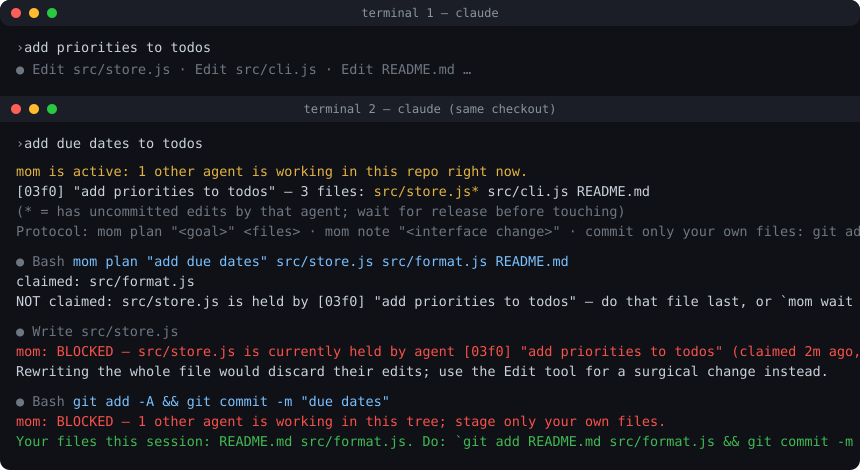

# mom

**Two agents. One checkout. Somebody has to make them share.**

mom keeps parallel AI coding agents (Claude Code sessions, Codex, Cursor, you) from overwriting each other in the same repo. It is an 850-line, zero-dependency CLI that installs as a Claude Code plugin. No supervising agent, no LLM calls, nothing written into your repo, zero tokens when you work alone.



## Install

```
/plugin marketplace add josephrich98/mom
/plugin install mom@mom
```

That's it. From the next session, every git checkout you open is covered. No `init`, no settings edits, no `.gitignore` entry: state lives in `~/.mom/`.

CLI for other agents and humans: `npm i -g mom-cli`. Per-repo opt-in without the plugin: `mom init` (see [docs/other-agents.md](docs/other-agents.md)).

## What breaks without it

Three headless Claude Code agents, one checkout, overlapping tasks, no coordination. From the benchmark transcripts:

- **They rewrite each other's files.** Three Haiku 5.5 agents: 18 whole-file `Write`s in one trial, 7 "file modified since read" errors, and a final tree where `todo add` no longer works (10 of 32 acceptance checks). With mom: 32/32 in every trial.
- **They commit each other's half-finished work.** Told to commit when done, every uncoordinated Sonnet 5.5 trial used `git add -A` at least once. One agent created a worktree, committed there, then ran `git update-ref` and `git reset` in the shared tree. With mom: zero tree-wide git commands in nine trials.
- **They give up.** With a 15-second test suite, 3 of 9 uncoordinated agents ended their run with the suite red: *"All 10 fail because of other agents' edits to the shared tree… I left that work alone."* The last agent standing spent seven minutes cleaning up. With mom: 0 of 9.
- **They invent their own coordination.** Uncoordinated Haiku agents wrote `sleep 60; md5sum src/*.js` and `until grep -q priorityOption src/cli.js; do sleep 1; done` to wait for each other.

## What the second agent sees

```
mom is active: 1 other agent is working in this repo right now.
  [03f0] "Add priority field to todos" — 3 files: src/store.js* src/cli.js README.md
  (* = has uncommitted edits by that agent; wait for release before touching)
```

If it tries to rewrite `src/store.js` while that agent is mid-edit:

```
mom: BLOCKED — src/store.js is currently held by agent [03f0] "Add priority field to todos" (claimed 2m ago, 3 edits so far).
Rewriting the whole file would discard their edits; use the Edit tool for a surgical change instead.
```

If it tries `git add -A`:

```
mom: BLOCKED — 1 other agent is working in this tree; stage only your own files.
Your files this session: README.md src/format.js. Do: `git add README.md src/format.js && git commit -m "..."`
```

When the first agent finishes with a file, the second is told to re-read it. Interface changes travel as one-line notes. Nobody's edits vanish.

## Numbers

Headless Claude Code agents started five seconds apart in one checkout of a small todo CLI, each with tasks that touch the same five files (ESM migration, async refactor, a field rename, due dates, priorities, `--json` and `edit`). Acceptance is 32 scripted checks of the final tree (tests green, every feature works end to end, README updated). n = 3 trials per cell, Sonnet 5.5 unless noted. Full tables, caveats and per-trial data: [bench/README.md](bench/README.md).

| Scenario | Metric | without mom | with mom |
|---|---|---|---|
| **Haiku 5.5**, 3 agents × 2 tasks | Acceptance (of 32) | 24.7 ± 12.7 | **32.0 ± 0.0** |
| | Stale-read / edit-mismatch errors | 7.0 | 0.3 |
| **Slow test suite** (15 s), 3 agents × 2 tasks | Agents that quit with tests red | 3 of 9 | **0 of 9** |
| | Wall-clock, all agents done | 240 s ± 170 | 173 s ± 15 |
| **Six agents**, 1 task each | Times an agent ran tests into someone else's breakage | 14.0 | **3.0** |
| | Test runs | 33 | 17 |
| **Commit when done**, 3 agents × 2 tasks | `git add -A` / `commit -a` / stash / reset | 2.0 per trial | **0** |
| | Wall-clock | 136 s | 105 s |
| **Fast suite, 3 agents × 2 tasks** (v0.3 runs) | Thrash | 7.0 | 1.0 |
| | Cost | $0.54 | $0.47 |

What this says, honestly:

- **Sonnet 5.5 agents with a fast test suite don't need saving.** In every one of those trials, both conditions produced a perfect final tree. They re-read before editing, Claude Code's `Edit` tool refuses stale edits, and a one-minute task leaves a tiny collision window.
- **mom pays off when the model rewrites whole files** (Haiku: 25 → 32), **when tests are slow** (agents stop abandoning red suites; wall-clock 240 → 173 s and far less variance), **when there are many agents** (thrash 14 → 3), and **when agents commit** (no more `git add -A`).
- **Cost is a wash** (−17% to +12%, within noise at n = 3). Turns go up 20–75% in heavy-collision scenarios: blocks, re-reads and waits are not free.
- **Caveats.** Tiny repo, synthetic tasks, agents told up front that others are present, three trials per cell. Benchmark PRs on bigger repos and other agents are the most useful contribution.

## How it works

Every file an agent edits is **claimed** for that agent until its turn ends. Claims are one small JSON file each, created with `O_EXCL`, so *checking* whether a file is free and *taking* it is one atomic operation. No daemon, no lock server; the filesystem is the arbiter.

| Failure mode | What mom does |
|---|---|
| Both agents see a file as free at the same moment | Check-and-claim is a single atomic `open(O_EXCL)`. |
| An agent rewrites a file someone else is mid-edit on | Whole-file `Write`, `cat >`, `sed -i`, heredocs and inline scripts aimed at a held file are blocked. Surgical `Edit`s go through with a one-time heads-up to both sides. |
| An agent commits other agents' half-finished work | `git add -A`, `commit -a`, `stash`, `checkout .`, `reset`, `update-ref` are blocked while others are present, with the exact `git add <your files>` to run instead. A plain commit that includes a file someone is mid-edit on gets a heads-up naming them. |
| An agent crashes holding files | Claims die with their owner's process; reservations expire after 15 idle minutes. Reaping uses `rename()` so only one reaper wins. |
| Two files depend on a changing interface | `mom note "<what changed>"` reaches the other agents after their next tool call. |
| An agent read a file that another agent then changed | Releasing an edited file logs a handoff; others are told once to re-read it. |
| Idle agents hog files | The Stop hook releases everything at end of turn; the next edit re-claims. |
| Two waiters hold what the other wants | `mom wait` detects the cycle within seconds; the agent that joined later yields. |

Two modes. **Advisory** (default) blocks only the destructive moves above and warns on the rest. **Strict** (`MOM_MODE=strict` or `mom init --mode strict`) also blocks every edit to a held file and every commit that includes a file under edit; it is for agents that rewrite whole files or don't re-read.

The agents follow four cheap habits, taught by the bundled skill and repeated in a ~150-token brief at session start (only when someone else is present):

1. `mom plan "<one-line goal>" <files>` before the first edit.
2. `mom note "<what changed>"` after changing a shared interface.
3. `git add $(mom mine) && git commit` — commit only your own files.
4. On BLOCKED: do other files first, or `mom wait <file>` and re-read.

## Commands

```
mom status [--json]              who is here, who holds what, recent notes
mom plan "<goal>" [files...]     announce your work; reserve files
mom note "<text>"                broadcast an interface change
mom mine                         files you edited this session (git add $(mom mine))
mom claim <files...> [--wait]    reserve files (hooks do this automatically for Edit/Write)
mom wait <file> [--timeout S]    block until a file is free and nobody is mid-edit on it
mom release <files...> | --all   hand files back early
mom who <file>                   who holds a file
mom inbox                        updates from others since you last looked
mom log                          raw event log
mom where                        where this checkout's state lives
mom init [--mode strict]         opt a repo in explicitly: .mom/ in the repo, hooks in .claude/settings.json
```

Environment: `MOM_AGENT` (identity; Claude Code sessions are detected automatically), `MOM_HOME` (state root, default `~/.mom`), `MOM_ROOT`, `MOM_MODE`, `MOM_TTL_SEC` (default 900), `MOM_DISABLE=1`.

## Works with

- **Claude Code**: full enforcement via plugin hooks (`SessionStart`, `UserPromptSubmit`, `PreToolUse`, `PostToolUse`, `Stop`, `SubagentStop`, `SessionEnd`). Parallel subagents inside one session are tracked as separate agents.
- **Codex, Cursor, Aider, humans**: cooperative, through the same CLI; claims taken from any tool are honoured by the Claude Code hooks. See [docs/other-agents.md](docs/other-agents.md).

## Design principles

- **Deterministic over clever.** Overlap detection is a string comparison; the participating agents, not a referee model, decide who yields.
- **Zero cost when alone.** No agents present → hooks print nothing.
- **Block the destructive, warn on the rest.** v0.1 blocked every overlapping edit and was slower for no gain; v0.4 tried blocking commits on files under edit and agents waited out their timeouts and gave up. Both are now advisory.
- **The board is derived, not edited.** A shared STATUS.md would be its own race. `mom status` renders from the claim files.
- **Plain files you can `cat`.** `mom where` shows the directory. Delete it to reset.

More in [docs/design.md](docs/design.md).

## FAQ

**Why not git worktrees?** Use them when tasks are independent. mom is for when they are not (two features touching the same modules), or when you don't want to plan ahead. Worktrees each get their own mom state, so the two compose.

**Does it touch my repo?** No. State is keyed by the checkout's path under `~/.mom/`. `mom init` is the opt-in alternative that puts `.mom/` (git-ignored) in the repo so non-Claude tools can share it.

**What if an agent needs a file someone else holds for a long time?** `mom wait <file>` blocks up to 3 minutes by default and returns early with instructions if it detects a circular wait. `mom claim --steal <file>` exists for when the holder is clearly gone but its process is still alive.

**Does this slow Claude Code down?** One Node process start (~40 ms) per hooked tool call.

**Does it work on Windows?** Claims and hooks are plain Node; liveness falls back to heartbeats where `kill -0` isn't meaningful. Untested so far; issues welcome.

## License

MIT
