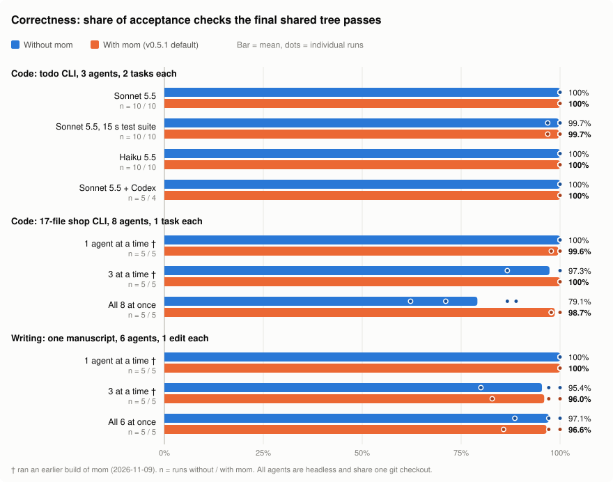

# mom

**Run several AI coding agents in one checkout without them destroying each other's work.**

mom is a Claude Code plugin (plus a small CLI for Codex and other tools). Its hooks see every edit, file read and shell command your agents make, and step in when one agent is about to wipe out another's work. It has no LLM, no daemon, no dependencies, and it writes nothing into your repo. An agent that isn't colliding with anyone never hears from it.


## Install

```
/plugin marketplace add josephrich98/mom
/plugin install mom@mom
```

That's it. Starting with your next session, mom covers every git checkout you open. Its state lives in `~/.mom/`. For Codex, Cursor or humans, install the CLI with `npm i -g mom-cli` (see [Works with](#works-with)).

## What it does

Agents sharing one checkout lose work in four ways. mom has one fix for each:

| How work gets lost | What mom does |
|---|---|
| **Whole-file overwrite.** Agent A is partway through editing `store.js`. Agent B writes its own version of the whole file (`Write`, `cat > f`, `cp`, a script that writes without reading), and A's changes are gone. | Every file an agent edits is **claimed** for it. Whole-file writes to a file another agent holds are **blocked**. Small in-place edits (`Edit`, `sed -i`) still go through, and both agents get a one-line heads-up. |
| **Stale overwrite.** B read a file ten minutes ago, A changed it since, and B writes its old copy back. | A shell overwrite of a file someone else changed since this agent last read it is **blocked** until the agent reads the file again. |
| **Stale paste.** B's script reads the file and rewrites one paragraph using text B saw earlier, which silently puts back words A had changed in that paragraph. It looks like an in-place edit, so nothing else catches it. | mom keeps a copy of each file as each agent last read it. After a write, it runs a word-level three-way merge. If the write undid someone else's change, mom **puts their change back**, keeps the writer's own change, and tells the writer. |
| **Tree-wide git.** Told to commit, an agent runs `git add -A` and commits everyone's half-finished work. Or it runs `git stash`, `git checkout .` or `git reset`, which wipe out the other agents' changes. | While another agent has files in play, these are **blocked**, and mom prints the exact `git add <your files>` to run instead. |

That's the core. Two smaller things fill in around it: when an agent finishes with a file that others have touched, they're told to re-read it, and `mom note "<what changed>"` lets an agent tell the others that it changed an interface they use.

Here is what an agent sees:

```
mom: heads-up — src/store.js is also being edited right now by [03f0]. Keep this edit small and local,
don't reformat or rewrite the file, and re-Read it before further edits.

mom: BLOCKED — src/store.js is currently held by agent [03f0] (claimed 2m ago, 3 edits so far).
Rewriting the whole file would discard their edits; use the Edit tool for a surgical change instead.

mom: BLOCKED — 1 other agent is working in this tree; stage only your own files.
Your files this session: README.md src/format.js. Do: `git add README.md src/format.js && git commit -m "..."`
```

**What it doesn't do.** It's a safety net, not a security boundary: mom recognizes shell writes by pattern, so an unusual script can get past it. It can't catch semantic conflicts either, such as an agent adding new code that uses a name another agent just renamed. And it doesn't make agents faster.

## Results

Headless agents worked in one shared git checkout on overlapping tasks, with no worktrees. An acceptance checker scored the final tree. Blue bars are runs without mom and orange bars are runs with mom. Bars show means and dots show individual runs.



| Scenario | Runs (without / with) | Fully correct runs | Checks passed | Tokens | Wall-clock |
|---|---|---|---|---|---|
| Code: todo CLI, Sonnet 5.5 | 10 / 10 | 10/10 → 10/10 | 100% → **100%** | 100k → 94k | 95 s → 86 s |
| Code: todo CLI, Sonnet 5.5, 15 s test suite | 10 / 10 | 9/10 → 9/10 | 99.7% → **99.7%** | 88k → 104k | 152 s → 155 s |
| Code: todo CLI, Haiku 5.5 | 10 / 10 | 10/10 → 10/10 | 100% → **100%** | 228k → 242k | 217 s → 269 s |
| Code: todo CLI, Sonnet 5.5 + Codex | 5 / 4 | 5/5 → 4/4 | 100% → **100%** | 90k → 90k | 166 s → 179 s |
| Code: 17-file shop CLI, 1 agent at a time † | 5 / 5 | 5/5 → 4/5 | 100% → **99.6%** | 240k → 244k | 311 s → 322 s |
| Code: 17-file shop CLI, 3 at a time † | 5 / 5 | 4/5 → 5/5 | 97.3% → **100%** | 286k → 289k | 159 s → 196 s |
| Code: 17-file shop CLI, All 8 at once | 16 / 11 | 2/16 → 8/11 | 76.9% → **99.2%** | 306k → 337k | 105 s → 157 s |
| Writing: one manuscript, 1 agent at a time † | 5 / 5 | 5/5 → 5/5 | 100% → **100%** | 88k → 81k | 121 s → 120 s |
| Writing: one manuscript, 3 at a time † | 5 / 5 | 3/5 → 3/5 | 95.4% → **96.0%** | 94k → 106k | 56 s → 63 s |
| Writing: one manuscript, All 6 at once | 20 / 20 | 7/20 → 16/20 | 81.0% → **97.9%** | 112k → 112k | 45 s → 38 s |
| Math: problem set + answer key, All 6 at once | 20 / 20 | 13/20 → 17/20 | 82.1% → **99.3%** | 91k → 96k | 26 s → 26 s |

† ran the 2026-11-09 build of mom. The three "all at once" mom rows are v0.6, and the other mom rows are v0.5.1 (v0.6 changes nothing that fires there). Measured 2026-11-09 to 2026-11-11 with Sonnet 5.5 unless noted. Regenerate the charts and this table with `node bench/charts.js`.

What the numbers say:

- **mom matters when many agents edit the same files at once.** With 8 agents on one 17-file codebase, runs without mom passed 77% of checks (2 of 16 fully correct). Features vanished when another agent rewrote a file under them. With mom, runs passed 99%. Six agents on one manuscript went from 81% to 98%: in 11 of 20 runs without mom, a stale paste-over lost an agent's whole task. Six agents on a problem set and answer key went from 82% to 99%. In every bad uncoordinated run, one agent saw edits it hadn't made and reverted them with `git checkout -- <files>`.
- **Otherwise it stays out of the way.** With 3 agents, or with tasks run one or three at a time, results are about the same with or without mom.
- **It costs about the same.** Tokens ranged from −6% to +18%, and wall-clock from −9% to +24%.
- **Caveats.** 5–20 runs per bar. The repos are small and synthetic, and the tasks finish in minutes. Some baselines were measured on different days from their mom runs, except for the v0.6 rows, which ran both arms side by side. Earlier claims that failed to replicate, the scenario details and the token and time charts are in [bench/README.md](bench/README.md). Benchmark runs on real repos are the most useful contribution.

## How it works

- **Claims.** Each claim is one small JSON file under `~/.mom/repos/<hash of checkout path>/claims/`. It is created with `O_EXCL`, so checking whether a file is free and taking it is a single atomic step. A claim goes away when the agent's turn ends, after 90 s without edits to that file (`MOM_IDLE_SEC`), or when the agent's process dies.
- **Snapshots.** For the lost-update repair, mom keeps the text of each file as each agent last read it in full (a `Read` with no offset or limit, or a plain `cat f`), plus the text just before that agent's write. Files over 1 MB are skipped. The merge is `bin/merge3.js`, about 70 lines.
- **Silence.** No hook prints anything unless the agent's action overlaps another agent's files. Everything is plain files: `mom where` prints the directory, and deleting it resets mom.

**Modes.** *Advisory* (the default) blocks only the destructive moves above. *Strict* (`MOM_MODE=strict` or `mom init --mode strict`) also blocks any edit to a file another agent holds, and any commit that includes one. Strict mode made agents 2–3× slower in the benchmark, so use it only for agents that rewrite whole files.

Design history (what was tried and dropped, and why): [docs/design.md](docs/design.md).

## Commands

Agents rarely need these. The hooks do the work.

```
mom status [--json]              who is here and who holds what
mom note "<text>"                tell agents that share your files about an interface change
mom wait <file> [--timeout S]    block until a file is free (detects circular waits)
mom release <files...> | --all   hand files back early
mom mine [--json|--null]         files you edited this session
mom who <file>                   who holds a file
mom begin <files...> [--wait]    claim files by hand (for agents without hooks)
mom inbox                        updates from others (for agents without hooks)
mom init                         opt a repo in: state in <repo>/.mom/, hooks in .claude/settings.json
mom init-codex                   install Codex hooks (then trust them with /hooks)
```

Run `mom help` for the rest (`plan`, `claim`, `log`, `leave`, `where`). Environment variables: `MOM_AGENT` (identity; Claude Code sessions are detected automatically), `MOM_HOME` (default `~/.mom`), `MOM_MODE`, `MOM_IDLE_SEC` (default 90), `MOM_TTL_SEC` (default 900), `MOM_DISABLE=1`.

## Works with

- **Claude Code**: full enforcement through plugin hooks. Parallel subagents in one session count as separate agents.
- **Codex**: `mom init-codex` installs native hooks. `apply_patch` edits are claimed like Claude Code edits, and shell commands are screened. A Sonnet + Codex run scored 100% with and without mom (n = 5 / 4). The 8-agent mixed run is still unmeasured because the Codex plan's usage limit ran out.
- **Cursor, Aider, humans**: cooperative, through the CLI (`mom begin`, `mom release`). The Claude Code hooks honor claims taken from any tool. See [docs/other-agents.md](docs/other-agents.md).

## FAQ

**Why not git worktrees?** Use them when tasks are independent. mom is for when they aren't (two features touching the same files), or when you don't want to plan ahead. Each worktree gets its own mom state, so the two work together.

**Does it slow Claude Code down?** Each hooked tool call starts one Node process, about 40 ms. Token and turn costs are in the table above.

**Windows?** It's plain Node. Where `kill -0` isn't meaningful, it checks heartbeats instead to tell whether an agent is still alive. It hasn't been tested on Windows yet.

## License

MIT
